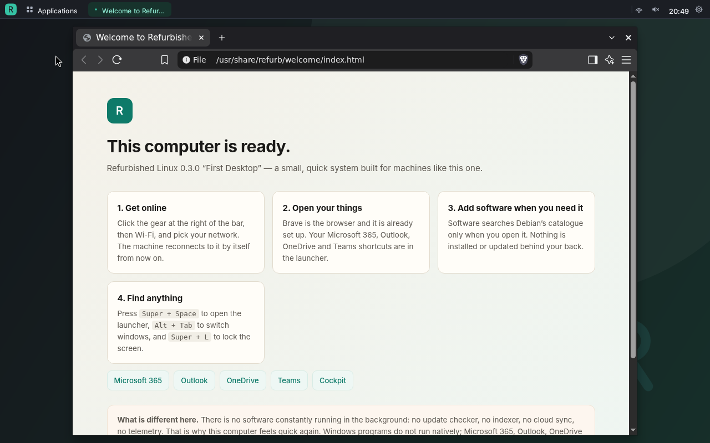

# Refurbished Linux 0.3.0 "First Desktop" — test report

Status: **the graphical desktop now boots and works on the release ISO.** The
installer is not in this release.

    ISO      refurbished-linux-0.3.0-amd64.iso
    size     810,549,248 bytes (773 MiB)
    sha256   b933349293d72034c86288f4c4a40b3ac086b1ee18fc95307befb4878fe00bff
    firmware BIOS (isolinux) + UEFI (grub efi.img), isohybrid MBR and GPT
    base     Debian 13 trixie, kernel 6.12.57-amd64

The screenshot above is the **release ISO** in QEMU with 2 cores and 2 GB RAM,
software emulation (this machine has no KVM), captured from the VM framebuffer
through the QEMU monitor. It is not a design mock-up: the bar, the window, the
wallpaper and Brave are all drawn by `refurb-shell` and `labwc` at runtime.

## Why 0.2 showed only the boot menu

The 0.2 session unit declared `User=1000`. The live image contained **only
root**, so systemd refused to spawn the unit:

    refurb-session.service: Failed at step USER spawning /usr/bin/refurb-session
    Main process exited, code=exited, status=217/USER

No graphical session ever ran, and because the image also had no framebuffer
console output the screen stayed on the isolinux frame. Fixed by:

1. **A real desktop account.** `refurb`, uid 1000, created at build time; the
   installer will create the user's own account instead.
2. **`/usr/lib/refurb/session-start`**, which resolves the first human account
   (uid ≥ 1000) at boot, repairs the ownership of its home directory (the
   rootless build leaves it owned by the build uid), creates
   `/run/user/<uid>`, and drops privileges with `runuser`. No hard-coded uid
   can break the session again.
3. **A seat.** A systemd system unit has no logind graphical session, so
   `libseat` refused the DRM device. `seatd` (about 1 MB) now provides it, and
   `LIBSEAT_BACKEND=seatd` is set for the session. This replaces a display
   manager entirely.
4. **Software renderer fallback.** `WLR_RENDERER_ALLOW_SOFTWARE=1` so VMs and
   very old GPUs still get a desktop. Hardware GL is used when present.
5. **A wallpaper surface.** `Subsurface::Desktop` did not exist: `open_layer`
   only knew the bar, launcher and quick settings, so nothing painted the
   background. It is now a real `zwlr_layer_shell` background surface, anchored
   to all four edges, excluded from the bar's exclusive zone, painted with the
   dark palette gradient, accent glow and R watermark. Output size changes
   arrive as layer configure events and reallocate the buffer.
6. **Seat capabilities** are created *and released* as the compositor
   advertises them; 0.2 called `get_keyboard()` unconditionally, which is a
   protocol error on a seat without a keyboard and killed the shell.

## Memory: measured, not estimated

Measured inside the running release ISO over the serial console. PSS is the sum
of `Pss:` from every `/proc/<pid>/smaps_rollup`, so shared pages are counted
once. It is not summed RSS.

| State | summed PSS | MemFree | Cached | MemAvailable | system occupancy |
|---|---|---|---|---|---|
| Desktop idle, no applications | **190 MB** | 601 MB | 1142 MB | 1572 MB of 1973 MB | ≈ 230 MB |
| Brave open, welcome page | 544 MB | 454 MB | 1158 MB | 1422 MB | ≈ 361 MB |

Largest processes when idle (RSS, from `ps`): `labwc` 146 MB, `refurb-shell`
45 MB, `NetworkManager` 19.5 MB, `wireplumber` 14 MB, `udisksd` 14 MB,
`systemd` 13.8 MB. Swap is zram: 986 MB, priority 100, 1 extent of 2 GB.

**Against the targets:** idle desktop is 190 MB PSS / ~230 MB occupancy, inside
the preferred 300–400 MB range and far below the 500 MB maximum — with Wi-Fi,
Bluetooth, audio (PipeWire + WirePlumber), udisks and Cockpit all present and
loaded. Two honest caveats:

- `labwc`'s 146 MB RSS is dominated by **llvmpipe** software-OpenGL buffers,
  which exist only because this VM has no GPU. On real hardware the same
  compositor allocates hardware-backed buffers and should be far smaller. That
  prediction is **not measured**.
- Brave with one page costs ~350 MB on top of the idle desktop. That is the
  browser, not the system, and it is the reason the idle figure matters.

## What else was verified

**Shell and recovery**
- `cargo test`: 16/16 pass.
- Headless wlroots run of the real image rootfs: `labwc` + `refurb-shell`,
  captured with `grim` (`screenshots/0.3.0-desktop-headless.png`).
- Crash recovery: `kill -9` of the shell produced
  `shell exited with 137, restarting in 2s` in
  `~/.local/state/refurb/session.log` and a new shell process (PID 14 → 35).
- Session unit: `Restart=on-failure`, `RestartSec=2`,
  `StartLimitIntervalSec=0` (moved to `[Unit]`, where systemd reads it).
- `getty@tty2..tty6` are enabled as text-login recovery consoles, and the
  serial console accepts a login.

**Boot and install medium**
- BIOS and UEFI El Torito entries both present; the ISO also has an isohybrid
  MBR and GPT, so the same file boots from USB or DVD.
- Boot menu: normal, verbose, and "Memory report" (adds `refurb.measure=1`,
  which runs `/usr/lib/refurb/memory-report` on the console after the desktop
  settles; inert otherwise).
- Bravery welcome page is shown on first boot, dark theme throughout.

## Known problems and things not done

1. **No graphical installer.** This is the largest gap: 0.3 installs nothing.
   Calamares or `live-installer` still has to be integrated, and until then the
   ISO is live-only.
2. **Brave extensions are configured, not verified.** `ExtensionSettings`
   installs h264ify and ResoWarden as `normal_installed` + pinned so the user
   can remove them. The VM here has no network, so neither extension has been
   observed running, and YouTube codec behaviour is untested.
3. **Wi-Fi and Bluetooth are untested.** Both stacks are installed and loaded
   (NetworkManager, BlueZ, PipeWire); this VM has no radio hardware.
4. **No physical hardware run.** Everything above is QEMU with software
   emulation. Nothing has been tested on a real 2 GB laptop.
5. **Suspend, audio output and keyboard/mouse interaction** are unverified.
   Input handling is implemented and the seat logic is correct, but no key or
   click was driven through the compositor in this round.
6. `getty@tty2..6` previously autologged-in a nonexistent `user`, restarting
   forever; the autologin drop-in is now removed at build time. The fix is in
   the source but the measurement above was taken with the consoles masked by
   hand on a test boot.
7. The live account `refurb` is **passwordless** by design (as on Debian live
   media). The installed system must create a real account with a password.
