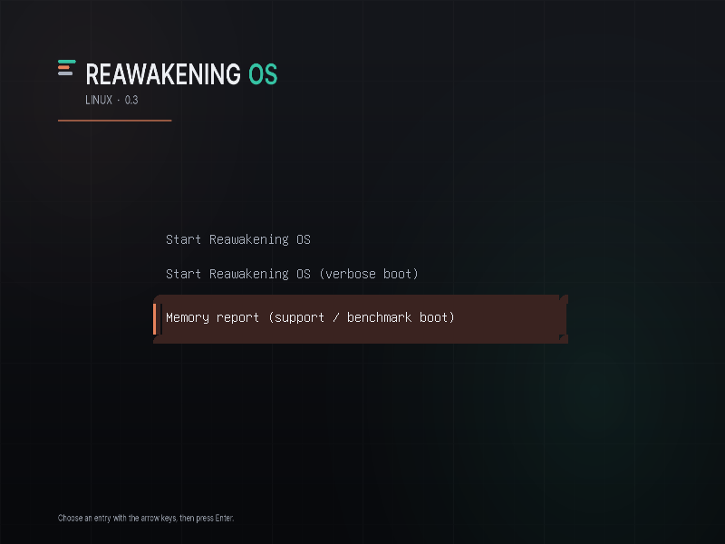
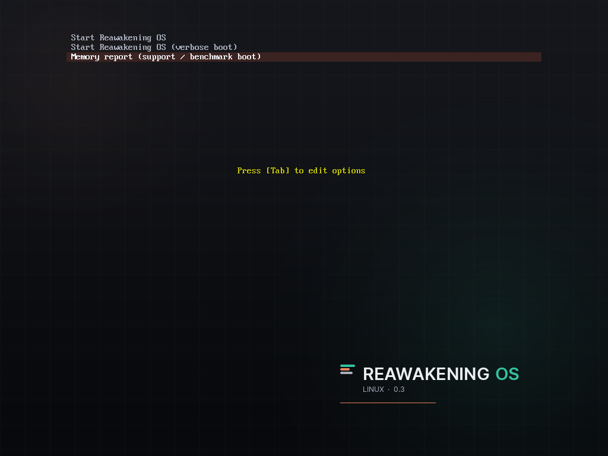
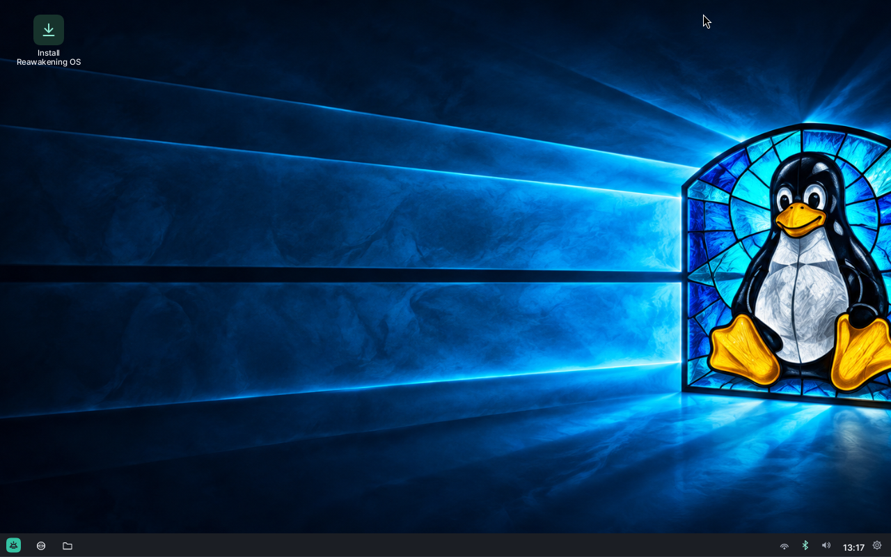
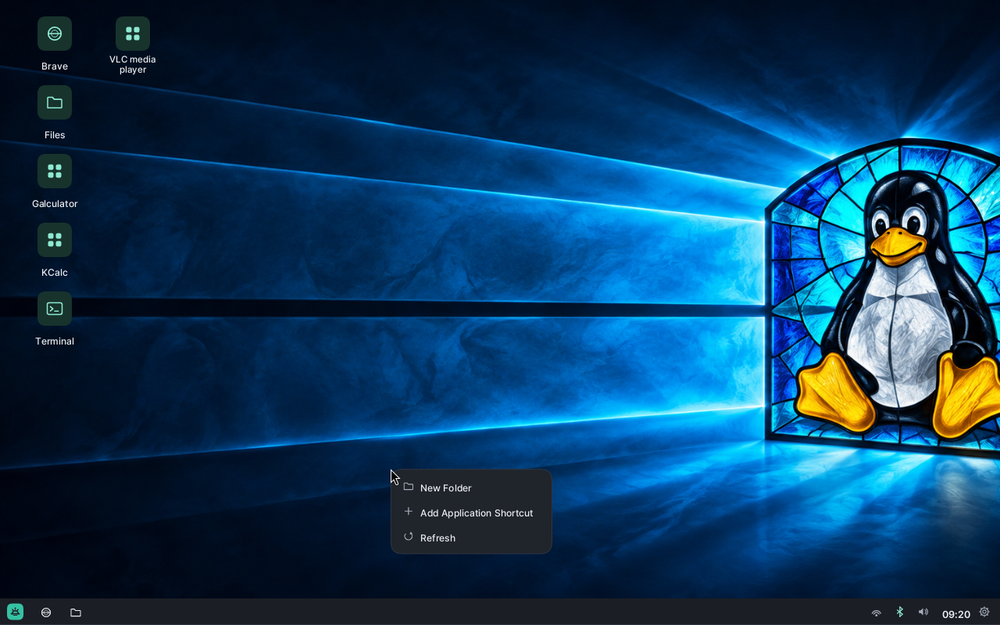
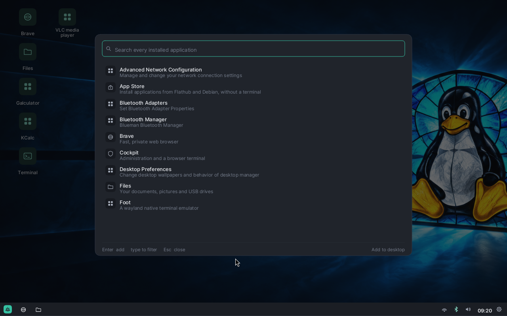
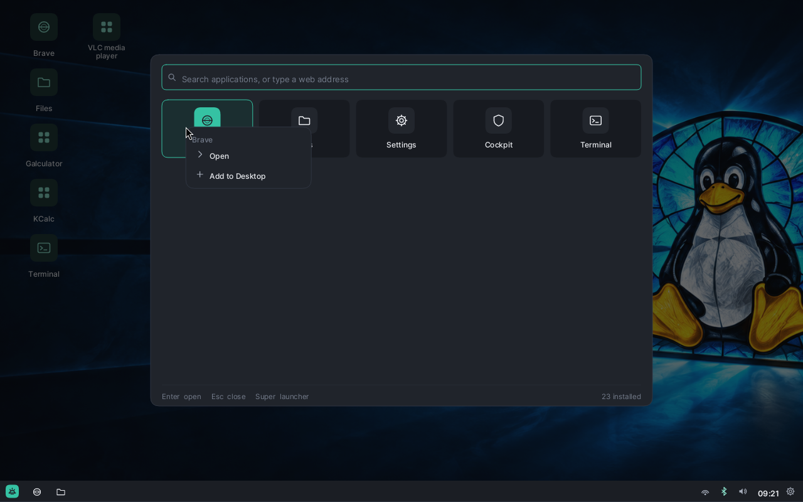

# Round 17.1 — the boot menu back in graphics, an installer on the desktop, every app one menu away

r17.1 is a usability round on the published r17, made while the owner was still
away from the hardware. Nothing was rebuilt: the desktop shell, Labwc, Brave,
Jellyfin, audio, Wi-Fi, Bluetooth, Cockpit, Calamares, Flatpak, APT and the
updater are carried over. Four things changed — the UEFI boot menu is the
branded graphic again, the live desktop carries an **Install Reawakening OS**
shortcut that the installed system does not, every installed application can be
put on the desktop from the launcher or the desktop menu, and a launch now opens
its window on the monitor whose launcher was used.

| | |
|---|---|
| Image | `reawakening-os-0.3.0-r17.1-amd64.iso` |
| Size | 1,272,578,048 bytes (r17: 1,263,861,760; r16: 1,237,876,736) |
| SHA256 | `007318ce6d733d643c61030ca30b77de333c0ee783110a9ec84cb36de312ddbf` |
| Rollback | r17 and r16 stay published |
| Branch | `refurb/0.3` |

## 1. The UEFI boot menu

r17 shipped GRUB's plain text menu on UEFI, because the themed menu it tried had
drawn its frame and countdown bar with no visible entries. That diagnosis was
half the story. Booting a series of instrumented EFI images under OVMF found
**two** independent faults:

1. **The font name did not match.** GRUB looks fonts up by their full PFF2
   name. The `unicode.pf2` in grub-common registers as
   `GNU Unifont Regular 16`; `theme.txt` asked for `Unifont Regular 16`. The
   theme loader found no font, so the menu list and its labels were drawn with
   nothing to draw them in — the background, selection pixmaps and progress bar
   still appeared. With the name corrected, the entries render.
2. **`terminal_output gfxterm` had never switched.** `insmod all_video` did not
   initialise a platform video driver in the standalone EFI image, so the menu
   stayed on the VGA text console (the blue 800×600 box in r17's screenshot).
   The image now loads `efi_gop` explicitly (with `efi_uga` as the fallback for
   firmware without GOP), and switches terminal only if the switch succeeds.

The theme files are now embedded in the EFI image itself, next to the `grub.cfg`
in its memdisk, so the menu does not depend on reading the medium before it can
paint. The copy under `/boot/grub/themes/reawakening` on the ISO and in the installed system is unchanged. The BIOS side keeps the r16/r17 isolinux artwork
and its bottom-right wordmark; only the UEFI path changed.

The fallback is deliberately two-layered: if `gfxterm` cannot set a mode, GRUB
stays on its text console and still lists the entries; if the theme cannot be
loaded, GRUB prints one error and falls back to its own text menu. Both were
observed on purpose during the investigation (the old font name produces the
second case), and neither can stop a machine from booting.

The installed system's GRUB now also sets
`GRUB_FONT=/boot/grub/fonts/unicode.pf2`, so `update-grub` loads the font the
theme names before the theme is read.

## 2. The installer on the live desktop

The live account's `~/Desktop` now contains
`Install Reawakening OS.desktop`, a 0755 copy of the same desktop entry the
application launcher uses (`Exec=refurb-installer`). It appears at first paint
of the live desktop, opens the normal Calamares workflow, and needs no trust
prompt: the file belongs to the live account and is not writable by anybody
else, which is exactly what the shell's shortcut check requires.

The installed system never sees it. Calamares builds the new account from
`/etc/skel`, removes the live account entirely, and `calamares-finalize` also
deletes the shortcut from the skeleton and from any home in the target. The
launcher's installer entry is removed by the same script, as before — an
installed machine has neither an installer icon nor an installer application.

The label needed one extra change: a 90-pixel desktop cell ellipsized
"Install Reawakening OS" to "Install Rew…". Grid cells are now 100 pixels wide
and a long name is balanced onto two lines at the same small label size
("Install" / "Reawakening OS"), instead of being cut. Short labels are still
one line, so the existing icon style is unchanged.

## 3. Every installed application on the desktop

The desktop menu's **Add Application Shortcut** no longer shows only the pinned
applications. It opens the launcher in a picker mode: the same search field, the
same catalogue, the same application entries, with **Enter add** in the footer.
That catalogue already includes APT applications, Flatpak exports
(`/var/lib/flatpak/exports/share/applications` and the per-user equivalent) and
anything installed while the session is running, because the launcher watches
those directories with inotify.

The launcher itself now has a right-click menu on any tile or search result:
**Open** and **Add to Desktop**. Both paths call one shortcut installer, which
copies the application's own `.desktop` file to the desktop. That matters for
Flatpak: the copy keeps `Exec=/usr/bin/flatpak run …` and the application id,
rather than guessing a binary name. The copy is 0755 and owned by the user, so
the existing trust check accepts it; **Move to Trash** removes the shortcut and
leaves the application installed.

Adding the same application twice is refused with "… is already on the desktop".
The first version of that check compared desktop-entry stems (`Brave` against
`brave-browser`), which never matches, so a second copy appeared; it now compares
the entry's `Exec` line, which is identical in the installed entry and its copy.

## 4. Launches stay on the monitor they started from

Labwc owns window placement, and its `<placement><policy>` is now `cursor`:
a new window is centred under the pointer. The launcher, the taskbar and the
desktop icons are all pointer-driven, so launching from monitor 2 has the pointer
on monitor 2 and the window opens there. Each monitor keeps its own bar, as in
r17, and an application that is already running is still just focused — the
policy applies to newly mapped windows, not to a second activation.

This is deliberately a compositor setting, not shell code that moves another
client's window: a Wayland client cannot place another application's surface,
and pretending otherwise would break under the first application that maps its
window late. The limit is that "under the pointer" is literally where the
compositor puts it; an application that requests a specific position through
`xdg-shell` may still choose its own.

## Preserved from r17

Six wallpapers, Settings → Appearance and live apply, right-click **Set as
Desktop Wallpaper**, personal wallpaper copies, drag-and-drop display
arrangement with per-EDID memory, Identify, resolution/refresh with the
15-second confirm and automatic revert, 12- and 24-hour clocks, a bar on every
screen, the layer-surface startup fix, GNOME Software with Flatpak, application
discovery without a reboot, Brave and Jellyfin, Cockpit, Calamares, audio,
Wi-Fi, Bluetooth, USB storage and the graphical updater. No update check,
daemon or resident service was added.

## Verified

- `cargo test` in `shell/refurb-shell`: **58 passed**, including the new
  shortcut lookup (an entry found by its `Exec`, a foreign entry not found).
- `scripts/check-config.sh`: all checks passed, including the new boot-menu,
  live-shortcut, launcher-picker and placement assertions.
- **UEFI boot menu**, from the shipped ISO under OVMF: the dark artwork, the
  wordmark, three entries, the clay selection highlight and the countdown bar
  are all visible (`docs/screenshots/r17-1-uefi-menu.png`).
- **BIOS boot menu**, from the same ISO: unchanged artwork, three entries clear
  of the wordmark (`docs/screenshots/r17-1-bios-menu.png`).
- **Live desktop**: the installer shortcut is present and two-line readable;
  Calamares starts from it (`docs/screenshots/r17-1-live-installer.png`).
- **Desktop picker**: opens from **Add Application Shortcut** and lists the
  catalogue; a launcher right-click shows **Open / Add to Desktop**.
- **Full installation** to a 20 GB virtio disk through the wizard (erase disk,
  account `refurbt`, password set). The installed disk boots with no medium
  attached; the desktop has no installer shortcut and a launcher search for
  `install` returns only the App Store.
- **Shortcut creation**: Brave, Files, Terminal, `galculator` (APT), VLC and
  `kcalc` (both Flatpak, installed from Flathub in the installed system) were
  added from the picker, which lists 23 applications; the Flatpak shortcuts
  carry their `flatpak run` Exec lines, and VLC started from its desktop
  shortcut (its first-run privacy page and main window). All six shortcuts were
  still there after a reboot (`docs/screenshots/r17-1-desktop-apps.png`).
- **Idle memory** on the installed system, 2 GB, 1280×800, terminal open:
  451 MB used of 1,973 MB, no swap used, buff/cache 486 MB, `refurb-shell`
  56 MB resident and labwc 154 MB.
- The clock read `08:41` in 24-hour mode; the wallpaper, bar and taskbar were
  the r17 ones.

## What this round did not verify

- **Physical hardware.** Everything above is QEMU with TCG. Craig's 2 GB
  machine, its Wi-Fi, audio and USB boot, and the Dell's display are still the
  owner's tests.
- **Two real monitors.** QEMU cannot present two active outputs, so the cursor
  placement is verified as a compositor setting and by the single-output launch
  path, not by two panels. Whether an application that insists on its own
  position ignores it is exactly the kind of thing the hardware pass will show.
- **A Flatpak installed through GNOME Software's button**; both Flatpaks here
  were installed with `flatpak install`, which is what the store's button
  ultimately runs.
- **Google Drive.** CURRENT STATUS and the master index were not reachable from
  the build environment.
